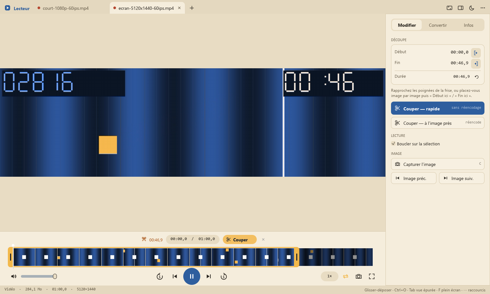
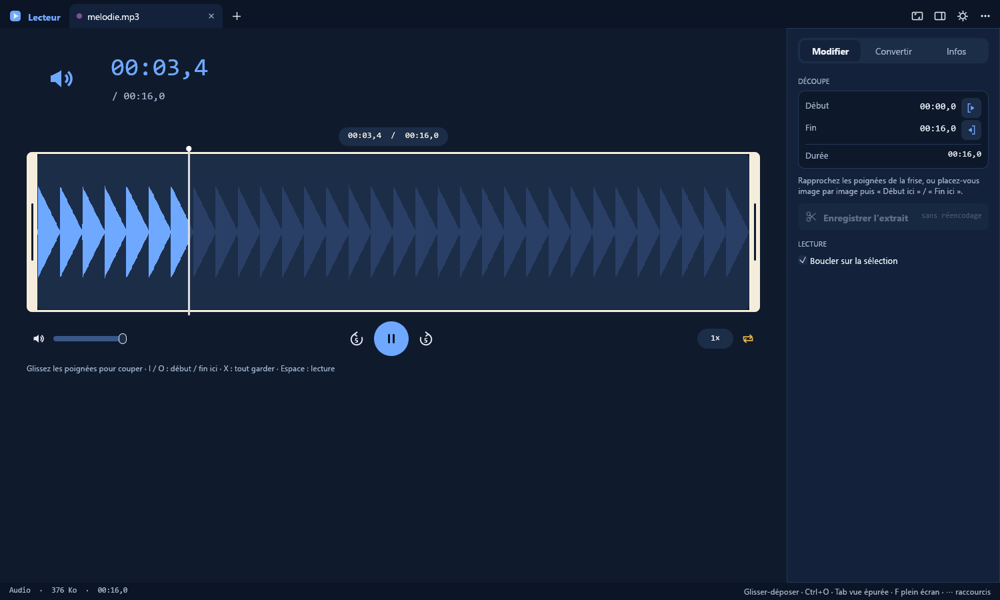
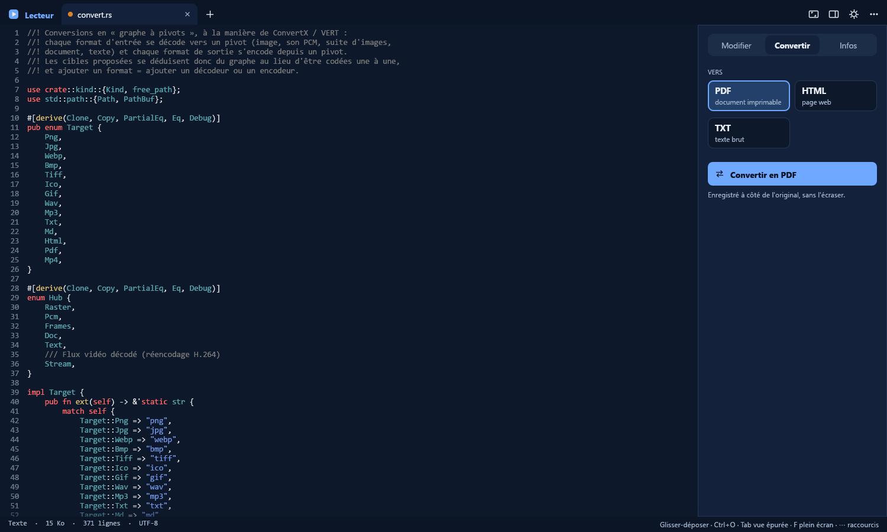
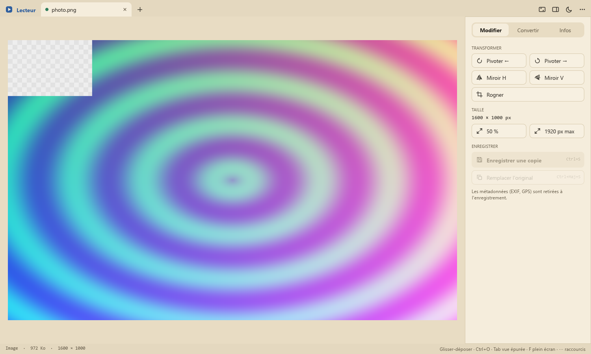
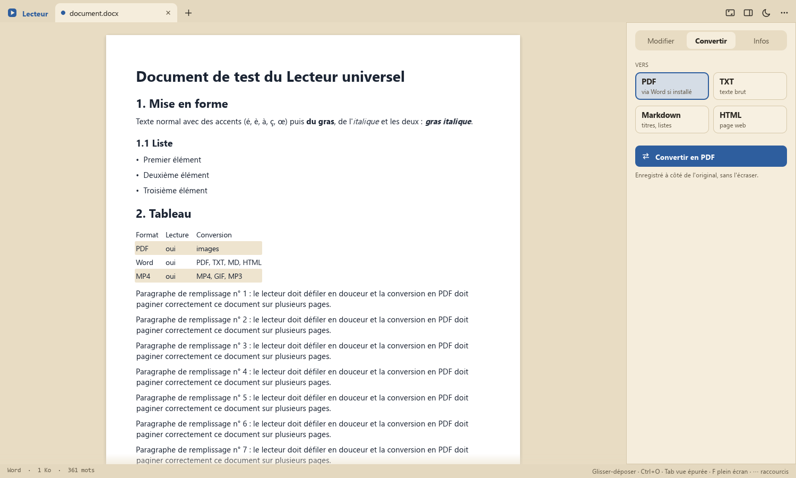

# Lecteur universel

**A lightweight universal file viewer, editor and converter for Windows, written in Rust.**
Open almost any file — documents, images, audio, video, code — and convert it to another format in one click.
Small single `.exe` (~12 MB), instant start-up, no runtime to install, no ffmpeg bundled: decoding and encoding are delegated to what Windows already ships (Media Foundation, Windows.Data.Pdf, WIC).

> The user interface is in **French** (the author's language). This README is in English.



| | |
|---|---|
|  |  |
|  |  |

## Download

1. Go to [Releases](https://github.com/Desarrh/lecteur-universel/releases/latest) and download `Lecteur-vX.Y.Z-windows-x64.zip`.
2. Unzip anywhere and run `lecteur-universel.exe`. Nothing to install.
3. Optional: menu **⋯ › « Ajouter à "Ouvrir avec" de Windows »** registers the app in Explorer's *Open with* menu (per-user, no admin rights).

**Automatic updates:** at start-up (at most once a day) the app asks GitHub for the latest release using Windows' built-in `curl.exe`. When a newer version exists, a banner offers *Installer et relancer*: the zip is downloaded to `%TEMP%`, the running exe is renamed to `.old`, the new one takes its place and the app restarts. You can disable the daily check or check manually from the **⋯** menu.

Requirements: Windows 10 or 11, x64.

## What it opens

| Type | View | Edit | Convert to |
|---|---|---|---|
| **Images** png, jpg/jpeg, webp, gif (animated), bmp, ico, tif/tiff — plus **HEIC/HEIF, AVIF, JPEG XR, camera RAW** (dng, cr2, cr3, nef, arw…) through Windows' own decoders | zoom (Ctrl + wheel, + / −, 0, 1), transparency checkerboard, animated GIF playback | rotate, mirror, crop (rule of thirds), resize, undo | **PDF** (A4 page per image, 1 cm margins, auto orientation; several images can be merged into one PDF; optional *scanned document* look that removes shadows and whitens the paper — handy for official papers photographed with a phone), PNG, JPG (quality), WEBP (lossy or lossless), BMP, TIFF, ICO, GIF |
| **PDF** | continuous pages, zoom, remembers the page, **text search (Ctrl+F)** with jump to page and excerpt, copy a page's text | — | PNG / JPG / WEBP (one image per page, ~200 dpi), **TXT**, HTML |
| **Word** .docx | headings, bold/italic, lists, tables, **embedded images** | — | PDF (**built-in PDF writer, no Microsoft Word needed**, images included; if Word happens to be installed it is used for a pixel-perfect layout), TXT, Markdown, HTML (images embedded) |
| **Text & code** (txt, md, json, toml, yaml, xml, html, css, js, ts, rs, py, c/cpp, cs, java, go, sh, ps1, sql, lua, gd, srt…) | syntax highlighting, line numbers (correct even with word wrap), current line, **Markdown preview** (Ctrl+E) | full editing, **find / replace** (Ctrl+F / Ctrl+H, match case, replace all), **go to line** (Ctrl+G), Ctrl+S saves the file (previous version kept as a backup) | PDF, HTML, TXT |
| **Audio** mp3, wav, m4a/aac, flac, wma | waveform, speed 0.25×–2×, loop | trim (MP3 is cut **without re-encoding**) | MP3 (128/192/320 kbit/s), WAV |
| **Video** mp4, mov, m4v, mkv, avi, wmv | thumbnail timeline, frame by frame, speed 0.25×–2×, frame capture (PNG + clipboard), **subtitles** (.srt / .vtt next to the video or dropped on it, adjustable offset) | trim with handles: **fast** (no re-encoding, keyframe-aligned) or **frame-accurate** (re-encoded H.264) | MP4 (resize / quality), optimised GIF, MP3, WAV, PNG |

Conversions follow a **hub graph** (inspired by ConvertX / VERT): every input decodes to a hub (raster image, PCM audio, frame sequence, document, text) and every output encodes from a hub, so available targets are derived automatically and adding a format means adding one decoder or one encoder (`src/convert.rs`).

Results are saved next to the original (never overwritten) and can be **dragged** straight from the side panel into Explorer, Discord, an e-mail…

## Quality of life

- **Clean view**: files opened from Explorer show the content only; `Tab` toggles the panels, `F` / F11 full screen.
- **Single instance with tabs**: opening another file adds a tab to the running window.
- **Neighbour files**: `PgUp` / `PgDn` (or ← → on images) open the previous / next file of the folder.
- **Resume**: video/audio position and PDF page are remembered; recent files on the home screen.
- **Batch conversion**: apply a conversion to every open tab of the same type.
- **Responsive layout**: below 900 px the side panel folds away; light (cream) and dark (navy) themes.

### Shortcuts

| Key | Action |
|---|---|
| Ctrl+K · F1 | command palette (every action, fuzzy search) · all shortcuts |
| Space / K | play / pause |
| ← → (Shift: 1 s) · J / L | seek ±5 s · ±10 s |
| , . | previous / next frame |
| I / O (or [ ]) | trim start / end here — X: keep everything |
| Shift+Home | jump back to the start of the selection |
| Media keys | play / pause, next / previous file — also from the Windows media flyout, even when the window is in the background |
| Esc · Space (quick preview) | close the preview opened with `--apercu` (separate instance, ← → open the neighbour file) |
| C | capture the current video frame |
| V · G / H | subtitles on/off · subtitle offset −/+ 0.1 s |
| Ctrl+F · Ctrl+H · Ctrl+G · Ctrl+E | find (with autocomplete: Tab completes) · replace · go to line · Markdown preview (text, code; Ctrl+F also searches PDFs) |
| Speed pill | click: faster · right click: slower · double click: 1× |
| Tab · F / F11 | clean view · full screen |
| Ctrl+O · Ctrl+W · Ctrl+Tab | open · close tab · next tab |
| Ctrl+S · Ctrl+Shift+S | text/code: save the file · save a copy — images: save a copy · replace the original |
| R / Shift+R · Ctrl+Z | rotate image · undo |

## Performance

Measured on the author's machine (Windows 11, NVIDIA GPU, 5120×1440 monitor), release build:

| | |
|---|---|
| Executable | ~12 MB, single file, no dependencies |
| Start-up | 0.1 – 0.5 s to first frame |

| File open | Private RAM |
|---|---|
| Empty window | 34 MB |
| MP3 | 43 MB |
| PDF | 115 MB |
| MP4 1080p 60 fps | ~145 MB |
| MP4 5120×1440 60 fps | ~600 MB (≈850 MB while the timeline thumbnails are computed) |

**Video playback**: the GPU decodes and presents the video directly in a child window placed under the UI (`src/vidwin.rs`), so no pixel goes through the CPU. Result: a 5120×1440 / 60 fps H.264 file plays at **60 fps with 0 dropped frames, both windowed and full screen**. Before this change (CPU copy path) full screen at that size dropped to 1–16 fps. Automatic fallbacks: GPU decoding with read-back, then software decoding (`LECTEUR_GPU=relecture` or `LECTEUR_GPU=0` to force them).

**UI rendering** is done on the CPU (egui + softbuffer, like the companion file explorer): no OpenGL/DirectX context for the interface, which saves the ~150 MB the GPU driver reserves. The GPU is only used while a video is open.

Other figures: 40 timeline thumbnails of a 1.8 GB / 12 min recording in about a second (decoder-side downscaling, coarse-to-fine order); fast video trim is a sample copy (no re-encoding); GIF export keeps only the pixels that change between frames (a 5 s clip went from 16.7 MB to 1.5 MB).

## Build from source

Requirements: [Rust](https://rustup.rs) (stable, MSVC toolchain, edition 2024) on Windows.

```
git clone https://github.com/Desarrh/lecteur-universel
cd lecteur-universel
cargo build --release
target\release\lecteur-universel.exe [files…]
```

Main crates: `egui` / `egui-winit` / `winit`, `softbuffer` + `hdrshot-egui-backend` (CPU renderer), `windows` (Media Foundation, WinRT PDF, WIC, Direct3D 11, Win32), `image`, `webp`, `gif`, `hound`, `zip`, `quick-xml`, `lopdf` (PDF text), `flate2`, `egui_extras` (syntax highlighting).

### Command line & tests

```
lecteur-universel --convert webp photo1.png photo2.jpg      # convert without opening a window
lecteur-universel --cut rapide|precis|720p in.mp4 3 9 out.mp4
lecteur-universel --assembler-pdf out.pdf [--scan] scan1.jpg scan2.jpg   # images → one PDF
lecteur-universel --generer-tests tests 5120 1440 60 60     # generate a folder with every supported format
lecteur-universel --selftest <folder with i.png i.jpg k.rs a.mp3 v.mp4>   # 7 automated editing tests
```

`--generer-tests` builds the test set used during development: images (a HEIC photo too when Windows' HEVC extension is installed), audio (mp3, wav, m4a, wma, flac), docx + pdf, 27 text/code files, short videos (one with a French `.srt` subtitle file) and a synthetic video at your screen resolution (frame counter, sweeping bar, bouncing square, flash + beep every second, so stutter or A/V drift is obvious). It is not stored in the repository because of its size.

Test switches: `LECTEUR_SHOT=out.png` (+ `LECTEUR_SHOT_MS`, `LECTEUR_SIZE=800x560`, `LECTEUR_DARK`, `LECTEUR_RAIL`, `LECTEUR_PANELS`) renders and saves a screenshot, `LECTEUR_EVENTS="1000:move 30 780;1100:down;1300:move 300 780;1400:up"` replays mouse/keyboard input, `LECTEUR_FPS=1` prints rendering and decoding rates.

## Known limitations

- No WEBM output (Windows has no VP9 encoder).
- DOCX → PDF without Microsoft Word: simple layout (standard fonts; images are included).
- HEIC needs the *HEIF Image Extensions* and *HEVC Video Extensions*, AVIF the *AV1 Video Extension*, camera RAW the *Raw Image Extension* (all from the Microsoft Store); HEVC / AV1 video likewise.
- PDF text search works on PDFs that contain text (not on scanned images); results jump to the page rather than highlighting the word.
- Subtitles: external .srt / .vtt only (subtitle tracks embedded in MKV/MP4 are not shown).
- UI in French only.

## License

[MIT](LICENSE) © Desarrh
